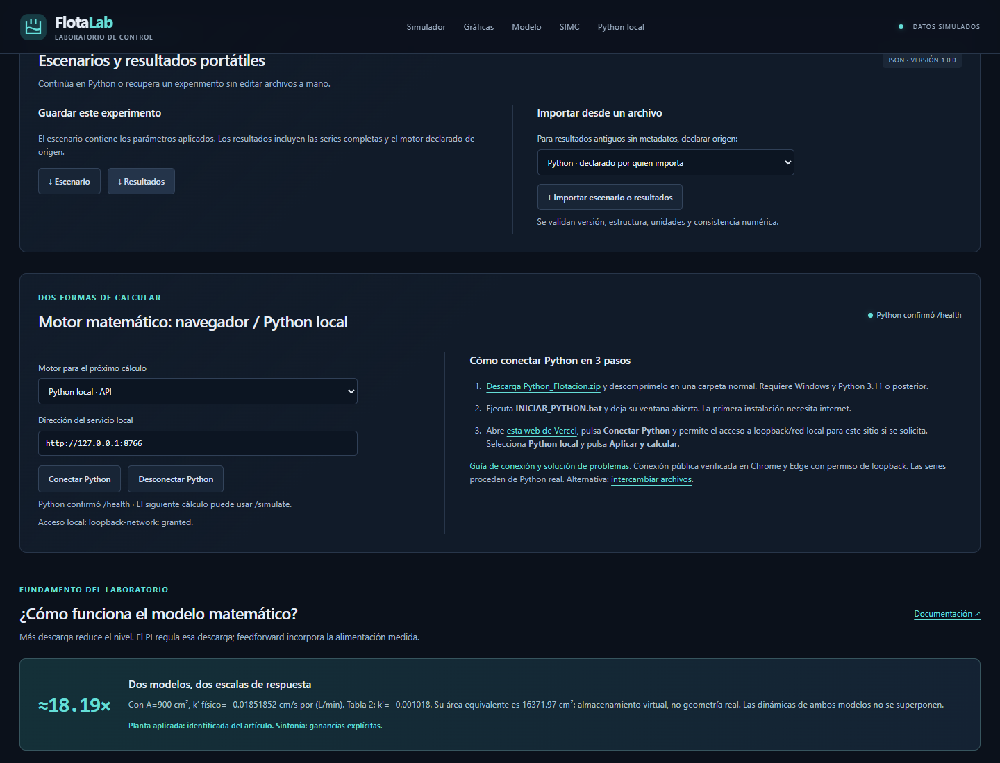
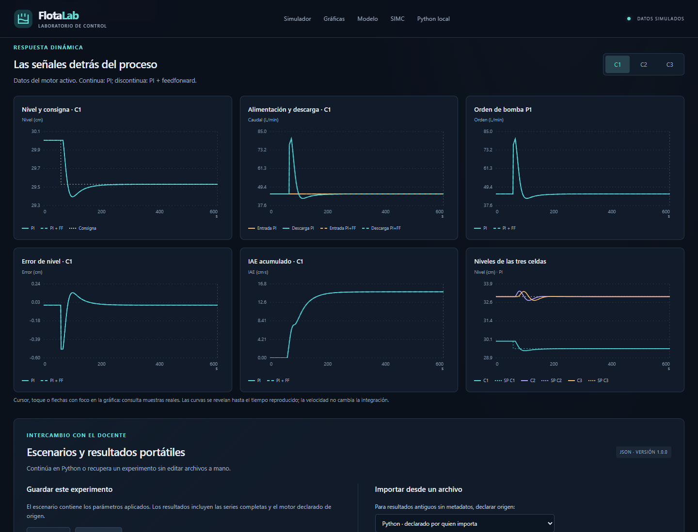
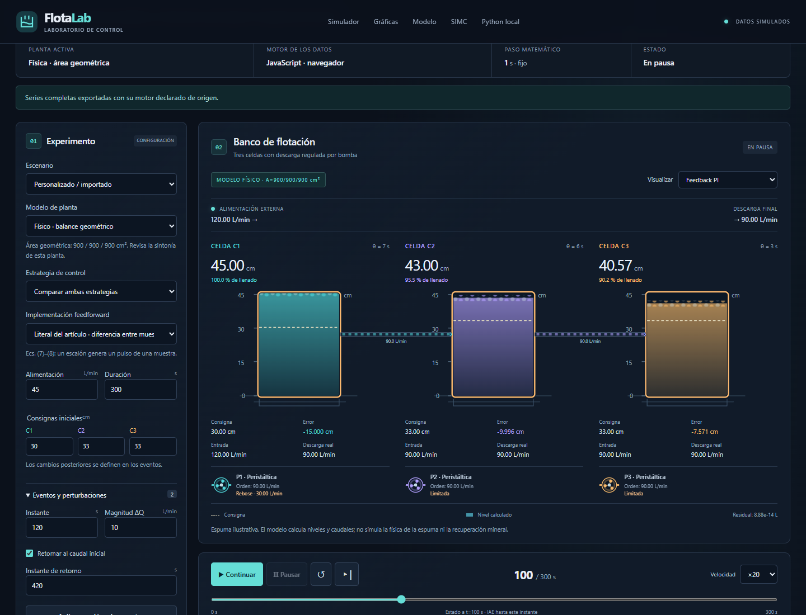

# FlotaLab: guía completa para el docente

Distribución **v1.0.1**, 16 de noviembre de 2026. Modelo, API y esquema **1.0.0**. Manual de operación y evaluación con nueve experimentos ejecutados en la interfaz pública. Todas las cifras propias son simuladas.

Web: [FlotaLab](https://flotacion-pi-methodsx.vercel.app). Código: [repositorio](https://github.com/etc031099/Flotacion-PI-Articulo-MethodsX). El paquete contiene este manual en Markdown y HTML; el HTML puede abrirse con doble clic sin servidor. El informe académico es un entregable separado; la guía no sustituye su discusión matemática.

## 1. Comprender el proceso

FlotaLab toma como referencia a Quintanilla et al. (2023), *A methodology to implement a closed-loop feedback-feedforward level control in a laboratory-scale flotation bank using peristaltic pumps*, MethodsX, DOI 10.1016/j.mex.2023.102081. Representa tres celdas en serie: la descarga de C1 alimenta C2 y la de C2 alimenta C3. Esta conexión permite estudiar el acoplamiento entre lazos.

P1, P2 y P3 son bombas de descarga. La bomba peristáltica representa un actuador de caudal del montaje de referencia; aquí su respuesta se idealiza con límites y retardo. No se simula una válvula única, ni la recuperación metalúrgica, la espuma o la distribución de partículas. No hay PLC, sensores ni bombas físicas conectados.

La alimentación es el líquido entrante; la descarga, el saliente. La consigna r es el nivel deseado. El PI usa el error e=r−h: su término proporcional actúa ante el error actual y su integral acumula el error. No es PID: no tiene derivada. El feedback corrige desviaciones del nivel; el feedforward usa cambios de alimentación medidos en la simulación para anticipar una perturbación.

SIMC calcula ganancias a partir de un modelo simplificado. IAE es la integral del valor absoluto del error, en cm·s: menor suele significar mejor seguimiento para un mismo escenario y horizonte. No mide por sí solo consumo, agresividad o robustez.

## 2. Recorrido completo de la web sin Python

1. Abra la web pública en Chrome o Edge. En Motor matemático elija **Navegador · JavaScript**.
2. Localice el panel **Experimento**. Los cambios pendientes no sustituyen los datos ya calculados.
3. Seleccione **Escenario**. Cambiarlo carga sus valores y calcula; comienza desde una configuración de referencia, no desde sus ediciones anteriores.
4. Elija **Modelo de planta**: identificado o físico. Revise la sintonización recomendada al cambiarlo.
5. En estrategia elija **Comparar ambas estrategias**, **Solo feedback PI** o **Feedback PI + feedforward**.
6. Escriba **Alimentación** en L/min; 45 es el valor inicial de referencia.
7. Escriba las consignas iniciales C1, C2 y C3 en cm; referencia 30, 33 y 33.
8. Establezca **Duración** en segundos enteros; por ejemplo 600. El máximo es 7200.
9. Abra **Eventos y perturbaciones**. Para un escalón de caudal, indique Instante, Magnitud ΔQ y, si corresponde, Instante de retorno; pulse **Aplicar escalón a los eventos**. Este botón sustituye los eventos de alimentación y conserva los de consigna. También puede **+ Añadir evento de consigna**, elegir señal, instante y valor absoluto o eliminar una fila con ×.
10. Pulse **Aplicar y calcular**. Espere el mensaje de cálculo completado.
11. Pulse **Iniciar** para reproducir los resultados.
12. Pulse **Pausar** para detener la animación.
13. Pulse **Continuar** para seguir desde ese instante.
14. El botón de avance, con título **Avanzar 1 s**, muestra la siguiente muestra.
15. **Reiniciar** devuelve la reproducción a t=0; no borra los parámetros ni recalcula.
16. Seleccione velocidad ×1, ×5, ×10 o ×20. Solo cambia la reproducción. El integrador siempre utiliza Δt=1 s.
17. Pulse **Ver resultado final →** para ir directamente a T. La barra temporal permite examinar instantes intermedios.
18. Consulte las seis gráficas: nivel/consigna, caudales, orden de bomba, error, IAE y niveles del banco.
19. Pulse **C1**, **C2** o **C3** para cambiar la celda de las gráficas individuales. **Visualizar** selecciona la estrategia mostrada en el banco.
20. Lea la tabla IAE al final para comparar el horizonte completo. Antes de T muestra el acumulado hasta el tiempo reproducido.
21. En las secciones de modelo consulte balances, signos, discretización y límites.
22. En SIMC compare parámetros reportados, calculados, finales y aplicados. Los valores iniciales calculados no son los finales experimentales.

**Restablecer parámetros del artículo** carga y calcula la referencia. **Escenario de perturbación** carga su escenario predefinido; no equivale necesariamente al experimento 3 de esta guía, que parte de equilibrio. **Comparación de controladores** calcula ambas estrategias.

## 3. Iniciar el programa Python en Windows

Descargue la distribución v1.0.1 desde Releases del repositorio. Descomprima todos los archivos en una carpeta normal, por ejemplo Documentos\FlotaLab. No ejecute el BAT desde dentro del ZIP. Necesita Python 3.11 o superior y conexión a internet para la primera descarga de dependencias.

Abra CMD o PowerShell en esa carpeta y compruebe:

```powershell
py -3 --version
```

Si no existe el lanzador py pero Python está instalado, pruebe `python --version`. Abra **INICIAR_PYTHON.bat**. Crea su entorno .venv y utiliza las versiones de requirements.txt; las siguientes aperturas reutilizan las dependencias compatibles. No necesita instalar Node ni FastAPI manualmente.

Mensajes reales del iniciador del servidor:

```text
FlotaLab - Motor matematico Python
API: http://127.0.0.1:8765
Abra la simulacion web y pulse Conectar Python.
Detenga el servidor con Ctrl+C.
INFO: Uvicorn running on http://127.0.0.1:8765 (Press CTRL+C to quit)
```

Mantenga abierta esa ventana. Abra esta dirección en el navegador:

```text
http://127.0.0.1:8765/health
```

Debe ver JSON con `status: "ok"`, `engine: "python"` y versiones 1.0.0. También puede usar:

```powershell
Invoke-RestMethod http://127.0.0.1:8765/health
```

HTTP 200 significa que la solicitud se atendió correctamente. Un 404 en `http://127.0.0.1:8765/` es normal: no hay página en la ruta raíz. No lo confunda con /health. Para terminar, use Ctrl+C en la ventana del servidor; el BAT puede pedir una tecla o confirmación de cierre.

## 4. Conectar HTML con Python y demostrarlo

1. Inicie el BAT y compruebe /health.
2. Abra la web de Vercel en Chrome o Edge. Vaya a **Python local**.
3. Confirme **Dirección del servicio local** = `http://127.0.0.1:8765`, sin añadir /health ni /simulate.
4. Pulse **Conectar Python**. Si el navegador pide acceso a la red local o loopback, autorícelo para este sitio. No cambie protecciones globales.
5. Espere **Python confirmó /health**. Esto comprueba disponibilidad, todavía no el cálculo del escenario.
6. En **Motor matemático**, seleccione **Python local · API**.
7. Pulse **Aplicar y calcular**. En comparación se envía una solicitud por estrategia.
8. Compruebe la procedencia **Python · API local** en la web.
9. Observe en la consola Python líneas reales `POST /simulate HTTP/1.1` con `200 OK`.
10. Cambie Alimentación, por ejemplo de 50 a 51, y aplique. Deben aparecer nuevos POST. Restaure después el valor para comparar el mismo escenario.
11. Pulse **Desconectar Python**. Esto desconecta el cliente; no termina el servidor.
12. Para seguir en el navegador, seleccione **Navegador · JavaScript** y pulse **Aplicar y calcular**.
13. Para reconectar, mantenga o vuelva a iniciar el servidor y repita Conectar, seleccionar Python y Aplicar.

### ¿Cómo sé que realmente Python está calculando?

**GET /health** comprueba disponibilidad y compatibilidad. **POST /simulate 200 OK**, junto con la procedencia **Python · API local**, acredita que la web recibió una respuesta de cálculo del servicio. Seleccionar Python o importar un archivo que declare origen Python no prueba por sí solo una ejecución de API. Los resultados importados se etiquetan como archivo de origen declarado.



En esta validación el puerto 8765 ya estaba ocupado y se usó **8766** sin detener el proceso existente. Para reproducir esa alternativa, inicie el BAT desde una terminal con:

```powershell
$env:FLOTALAB_PORT="8766"
.\INICIAR_PYTHON.bat
```

Cambie también la dirección de la web y la comprobación /health a 8766. La variable solo afecta esa terminal; vuelva a una terminal nueva para usar el puerto predeterminado. No necesita modificar ecuaciones ni código.

## 5. Diccionario práctico de controles y magnitudes

Las relaciones siguientes dependen del escenario, el retardo, la sintonización y la saturación. Las flechas no garantizan que el IAE mejore.

| Control o magnitud | Unidad y significado | Al aumentar / disminuir | Qué observar y precaución |
|---|---|---|---|
| Modelo identificado | k′=−0.001018 (cm/s)/(L/min) | No es una escala editable en el panel | Inventario equivalente; no llamarlo volumen geométrico |
| Modelo físico | A=900 cm²; k′=−0.0185185 (cm/s)/(L/min) | Más respuesta de nivel por el mismo desequilibrio que el identificado | Recalcular SIMC; no aplicar simultáneamente ambos modelos |
| Alimentación inicial | L/min; valor de entrada y sesgo inicial | Aumentarla aumenta también el sesgo de bombas; disminuirla reduce ambos | No equivale a un escalón posterior. Admite 0–90 inicialmente |
| Duración | s; horizonte entero 1–7200 | Aumentar incluye más evolución; disminuir puede cortar eventos | Comparar IAE con igual T; no aumenta la precisión temporal |
| Consignas C1/C2/C3 | cm; referencia de cada nivel | Subir exige inicialmente reducir descarga; bajar exige aumentarla | Si se cambia solo r inicial con h inicial fijo, ya hay error en t=0 |
| Nivel inicial h0 | cm, en avanzado | Aumentar eleva inventario inicial; disminuir lo reduce | Mantenerlo igual entre estrategias; límites 0–45 cm |
| Estrategia | categoría | Comparar calcula PI y PI+FF con igual escenario | Las descargas internas pueden diferir entre estrategias |
| Implementación FF | categoría | Literal usa diferencia entre muestras; acumulada mantiene cambio respecto al sesgo | La acumulada es variante propia; no atribuirla al artículo |
| Evento | s y valor absoluto en cm o L/min | Mayor instante demora el cambio; mayor valor cambia su magnitud final | Evento de caudal 55 significa 55, no +55 |
| Perturbación ΔQ | L/min; incremento sobre alimentación inicial | Más ΔQ exige mayor descarga; menos puede requerir reducirla | El generador sustituye eventos de caudal; revise retorno y filas |
| Kc negativo | (L/min)/cm | Mayor valor absoluto suele actuar más fuerte; menor, más suave | Más agresividad puede oscilar y empeorar IAE; nunca usar Kc positivo |
| τi | s, positivo | Mayor integra más despacio; menor más deprisa | Evaluar sobreimpulso y saturación; no garantiza menor establecimiento |
| Kff | adimensional, 0–1 | Aumentar pesa más la compensación; disminuir la atenúa | Con Kff=0 desaparece el término FF; no implica superioridad universal |
| θ | s, [7,6,3] | Más retardo demoraría descarga; menos la adelantaría | No editable en esta interfaz. Se consulta en SIMC/JSON; no inventar un control |
| τc | s, [7,6,8] | En SIMC, mayor implica menor magnitud Kc; menor mayor | No editable en el panel; los experimentos usan ganancias permitidas |
| Orden de bomba u | L/min, limitada 0–90 | Mayor orden pide más descarga; menor menos | No es qout instantáneo por el retardo y disponibilidad de líquido |
| Nivel h | cm, estado 0–45 | Sube si entra más que sale; baja si sale más | En límites revise rebose y disponibilidad; no es parámetro de ganancia |
| IAE | cm·s, indicador acumulado | Aumenta con área de error; no disminuye con el tiempo | No editable. Compare mismo escenario, celda y horizonte |
| Velocidad de reproducción | ×1/×5/×10/×20 | Más rápida muestra muestras antes; menor más lentamente | No cambia Δt=1 s ni los resultados exportados |

Para editar Kc y τi abra **Parámetros avanzados** y elija **Ganancias explícitas · artículo o edición** en Sintonización. Con **SIMC calculado para la planta activa**, los valores se calculan; no se obtienen nuevos τc mediante esos campos. Las ganancias finales del artículo son Kc=[−62,−76,−85], τi=[56,30,44] s y Kff=[0.8,0.8,1.0].

## 6. Preparación común de los experimentos

Los experimentos 1–6 y 9 se ejecutaron realmente en la web pública con Chrome 157.0.8103.51; el 7 utilizó solicitudes reales a Python 3.12.10 y el 8 detuvo el proceso propio. No se interceptaron respuestas ni se cambiaron ecuaciones. Los IAE siguientes están redondeados a tres decimales; los archivos exportados contienen mayor precisión.

**Base E:** elija Navegador · JavaScript, escenario **Equilibrio del banco**, modelo **Identificado · k′ del artículo**, **Comparar ambas estrategias**, duración 600 s. Confirme alimentación 45, niveles iniciales y consignas [30,33,33], ganancias finales del artículo y FF literal. No debe haber eventos. Pulse Aplicar y calcular. Para cada repetición vuelva a seleccionar este escenario; no basta Reiniciar, que solo mueve el reloj.

Para añadir el escalón de consigna usado abajo: Eventos y perturbaciones → **+ Añadir evento de consigna** → señal **Consigna C1 (cm)**, instante **60**, valor absoluto **29.5**. Después **Aplicar y calcular** → **Ver resultado final →**.

Las cifras IAE se leen como [C1,C2,C3] en cm·s. Para evaluar tiempos, elija primero un criterio, por ejemplo permanecer a ±0.02 cm de la consigna después del último cambio; ese umbral es un criterio propuesto para análisis, no una prestación automática del panel. Con varios eventos no hay un único tiempo de establecimiento.

### Experimento 1. Equilibrio del banco — básico

**Objetivo:** comprobar conservación sin perturbaciones. **Hipótesis:** con entrada y descarga iguales no cambia ningún nivel.

**Configuración y pasos:** cargue Base E sin eventos. Aplique, pulse Iniciar, Pausar, avance 1 s, Continúe y vaya al final. Pruebe Reiniciar: debe volver a cero conservando las curvas.

**Observación validada:** h=[30,33,33] cm; caudales y órdenes 45 L/min; IAE=[0,0,0] para ambas estrategias durante 600 s. No hay un transitorio de estabilización porque la condición inicial ya está en equilibrio.

**Explicación:** qin−qout=0, e=0 y la integral no cambia. **Preguntas:** ¿por qué no actúa el PI?, ¿qué pasaría si h0 fuera distinto de r? **Restauración:** vuelva a Base E.

### Experimento 2. Cambio de setpoint — básico

**Objetivo:** observar el signo y acoplamiento del PI. **Hipótesis:** bajar la consigna de C1 aumenta inicialmente su descarga y afecta a C2/C3.

**Configuración y pasos:** Base E; añada solamente C1=29.5 cm en t=60 s con el editor indicado. Aplique, reproduzca y examine C1 alrededor de 60–80 s; luego seleccione C2 y C3 y vaya al final.

**Observación validada:** IAE PI=[15.025,15.111,16.827]; PI+FF=[15.025,14.768,16.244]. La descarga no cambia al mismo instante que la orden: hay retardo. Las consignas C2 y C3 siguen en 33 cm.

**Explicación:** e=r−h es negativo al bajar r; Kc<0 genera incremento de orden. La descarga de P1 es alimentación de C2. **Preguntas:** ¿por qué cambia C2 si su consigna no cambió?, ¿qué distingue orden y caudal? **Restauración:** Base E elimina el evento.



### Experimento 3. Perturbación en la alimentación — intermedio

**Objetivo:** seguir una perturbación externa por las tres celdas. **Hipótesis:** el PI compensa el exceso de entrada, con respuestas distintas aguas abajo.

**Configuración y pasos:** Base E, sin eventos de consigna. En el generador indique Instante=120, Magnitud ΔQ=10; marque Retornar al caudal inicial e Instante de retorno=420. Pulse Aplicar escalón a los eventos. Revise dos filas de alimentación: 55 en 120 y 45 en 420. Aplique, reproduzca y seleccione sucesivamente C1/C2/C3 en caudales y niveles.

**Observación validada:** T=600; IAE PI=[17.959,11.068,14.009]; PI+FF=[17.956,10.964,13.945]. La alimentación externa cambia inmediatamente; la descarga responde con su retardo y control. No se impone que C2 reciba el escalón externo en el mismo instante.

**Explicación:** qin,2=qout,1 y qin,3=qout,2. **Preguntas:** ¿cuál es la señal medida por cada FF?, ¿por qué el retorno genera otro transitorio? **Restauración:** Base E.

### Experimento 4. Feedback y feedforward literal/acumulado — intermedio

**Objetivo:** comparar estrategias sin favorecer artificialmente ninguna. **Hipótesis:** la forma de FF cambia la compensación; no necesariamente beneficia todas las celdas.

**Configuración y pasos:** pulse Restablecer parámetros del artículo. Elija Comparar ambas estrategias y T=900; alimentación 45, modelo identificado, ganancias finales. Revise eventos: C1=29 en 60; C2=32 en 180; C3=32 en 300; alimentación 55 en 420 y 45 en 600. Seleccione FF **Literal del artículo · diferencia entre muestras**. Aplique y vaya al final. Exporte Resultados. Cambie solo Implementación feedforward a **Acumulada · variante propia**, aplique y vuelva al final; exporte por separado.

| Implementación | IAE PI | IAE PI+FF |
|---|---|---|
| Literal | [42.345,52.295,71.527] | [42.340,52.422,72.902] |
| Acumulada propia | [42.345,52.295,71.527] | [28.082,34.306,29.514] |

**Observación:** el literal empeora C2 y C3 en este caso; la variante acumulada mejora las tres aquí. No generalice a todos los escenarios. **Explicación:** una diferencia entre muestras produce un pulso ante un escalón; una diferencia respecto al caudal inicial persiste. **Preguntas:** ¿son equivalentes esas señales?, ¿puede atribuirse la variante propia al artículo? No. **Restauración:** Restablecer parámetros del artículo y comprobar FF literal.

### Experimento 5. SIMC y agresividad — avanzado

**Objetivo:** evaluar sobreimpulso, oscilaciones y establecimiento al editar ganancias permitidas. **Hipótesis:** más agresividad puede empeorar el comportamiento por el retardo.

**Configuración y pasos:** Base E; cambie a **Físico · balance geométrico** y seleccione en avanzado **SIMC calculado para la planta activa**. Añada C1=29.5 en 60, T=600. Calcule y exporte. Para cada variante siguiente seleccione **Ganancias explícitas · artículo o edición**, escriba los tres Kc y τi, mantenga Kff y todo lo demás; aplique y exporte. No cambie θ ni τc: no existe editor para ellos.

| Caso | Kc C1/C2/C3 | τi C1/C2/C3 (s) | IAE PI |
|---|---|---|---|
| SIMC físico | −3.857143 / −4.5 / −4.909091 | 56 / 48 / 44 | [14.111,14.619,14.866] |
| Suave | −1.9285714285714286 / −2.25 / −2.4545454545454546 | 112 / 96 / 88 | [23.005,21.204,21.584] |
| Agresivo | −7.714285714285714 / −9 / −9.818181818181818 | 28 / 24 / 22 | [24.949,95.404,130.084] |

Use SIMC calculado para la primera fila para conservar su precisión completa. **Observación:** el caso agresivo empeora notablemente el IAE aguas abajo. Examine cruces de consigna y oscilaciones; no convierta IAE en una medida automática de sobreimpulso. Para cuantificar este último lea el máximo alejamiento por debajo de 29.5 tras el escalón descendente; mida establecimiento con el criterio definido antes.

**Explicación:** |Kc| mayor refuerza proporcional; τi menor acelera integral. El retardo limita cuánto puede acelerarse el lazo. **Preguntas:** ¿menor τi garantiza menor tiempo de establecimiento?, ¿basta mirar C1? **Restauración:** vuelva a SIMC calculado o Base E; Reiniciar no restaura ganancias.

### Experimento 6. Modelo físico frente al identificado — avanzado

**Objetivo:** distinguir ganancia y almacenamiento sin mezclar plantas. **Hipótesis:** cambiar la escala física cambia órdenes; con SIMC recalculado los niveles pueden ser casi iguales.

**Configuración y pasos:** Base E con C1=29.5 en 60 y T=600. Seleccione modelo identificado y **SIMC calculado para la planta activa**, calcule y exporte. Cambie solo a modelo físico, confirme que sigue SIMC calculado, aplique y exporte. Compare niveles, órdenes y tabla SIMC.

**Observación validada:** ambos modelos dan IAE PI=[14.111,14.619,14.866] y FF=[14.111,14.275,14.232]; diferencia máxima de niveles de aproximadamente 1.21×10⁻¹³ cm. Esto es un resultado esperado de esta configuración sin perturbación externa de caudal, no un fallo del selector.

La planta física tiene A=900 cm²; la identificada usa almacenamiento equivalente Aeq≈16371.971 cm². La magnitud de ganancia difiere por ≈18.191. SIMC compensa inversamente esta ganancia: Kc identificado≈[−70.166,−81.860,−89.302], físico≈[−3.857,−4.5,−4.909]. El producto k′Kc coincide, conservando aquí la dinámica del nivel mientras cambia la escala de las acciones de caudal. Con otras entradas o saturación no debe suponerse equivalencia.

**Preguntas:** ¿por qué curvas parecidas no prueban modelos idénticos?, ¿es Aeq geometría real? No. **Restauración:** Base E; confirme sintonización final del artículo si va a repetir experimento 2.

### Experimento 7. Integración real JavaScript–Python — avanzado

**Objetivo:** verificar que ambos motores resuelven el mismo escenario. **Hipótesis:** coinciden salvo redondeo numérico.

**Configuración y pasos:** en Navegador pulse Restablecer parámetros del artículo; Comparar ambas estrategias, identificado, T=900, FF literal. Cambie alimentación inicial a **50** y consigna inicial C1 a **31**; conserve h0,C1=30 y las cinco filas de eventos originales, incluido retorno a **45** en t=600. Aplique. Exporte **↓ Escenario** y **↓ Resultados**; guarde este último como resultado_js.json.

Conecte Python según sección 4, selecciónelo y aplique sin editar la configuración. Compruebe origen y POST, exporte como resultado_python_api.json. Vaya al final: IAE PI≈[106.030,83.227,98.313], FF≈[106.027,83.229,100.219]. En la validación de todas las series entre motores la diferencia máxima fue 2.27×10⁻¹³, con tolerancia absoluta 10⁻⁹ y relativa 10⁻¹¹.

Para comprobar también el intercambio por archivos, copie el escenario descargado a la carpeta del paquete con nombre flotalab_escenario.json y ejecute allí:

```powershell
py -3 simulacion_flotacion.py flotalab_escenario.json --output resultados_python.json --strategy compare
```

En **Escenarios y resultados portátiles**, pulse **↑ Importar escenario o resultados** y elija resultados_python.json. Un resultado importado conserva origen declarado; importar un escenario recalcula usando el motor seleccionado. Los archivos exportan el cálculo completo, aunque la animación esté en t=0. Exporte después de aplicar, para no guardar parámetros pendientes.

**Explicación:** JSON es el contrato versionado con unidades, configuración y series; no transmite imágenes de gráficas. **Preguntas:** ¿/health demuestra cálculo?, ¿igual IAE garantiza igualdad de cada muestra? No; por eso las pruebas comparan todas las series. **Restauración:** seleccione Navegador, aplique y vuelva a referencia.

### Experimento 8. Desconexión y recuperación — avanzado

**Objetivo:** verificar el fallo visible y la recuperación explícita. **Hipótesis:** perder Python no debe cambiar silenciosamente al motor JavaScript.

**Configuración y pasos:** complete una simulación con Python como en el 7. Detenga SU servidor con Ctrl+C. Espere al siguiente control de disponibilidad, aproximadamente 10 s más la espera de red. La web debe indicar **Sin conexión Python** y comunicar pérdida; los datos previos conservan su procedencia Python. No interprete esos datos como un cálculo nuevo.

Seleccione **Navegador · JavaScript**, pulse Aplicar y calcular y vaya al final. Debe indicar **JavaScript · navegador**. Reinicie el BAT y repita Conectar Python → seleccionar Python local · API → Aplicar. También puede usar Desconectar Python sin detener el servidor para practicar la desconexión voluntaria.

**Observación validada:** se detectó la terminación real del proceso propio y se pudo recalcular explícitamente con JavaScript. La ventana Python no debe cerrarse durante una demostración salvo para esta prueba. **Explicación:** disponibilidad de un servicio y procedencia de resultados son estados diferentes. **Preguntas:** ¿qué riesgo tendría un cambio silencioso de motor?, ¿Desconectar cierra el servidor? No. **Restauración:** deje el motor deseado seleccionado y aplique; cierre solo su servidor al terminar.

### Experimento 9. Saturación y rebose digital — avanzado

**Objetivo:** estudiar límites y conservación bajo un exceso de alimentación. **Hipótesis:** si la entrada supera la capacidad de descarga, el nivel alcanza el límite y aparece rebose contabilizado.

**Configuración y pasos:** Base E; modelo físico, SIMC calculado, duración **300**. En el editor añada dos eventos, cambiando la señal de cada fila a **Alimentación C1 (L/min)**: **120** en t=**30**, **45** en t=**150**. La alimentación inicial permanece en 45. El evento puede superar 90; el campo de alimentación inicial no. Aplique y sitúe el tiempo alrededor de 100; examine banco, órdenes y niveles. Vaya al final y exporte para consultar el rebose de las series.

**Observación validada:** niveles no superiores a 45 cm y órdenes no superiores a 90 L/min; hay rebose registrado. IAE PI=[1957.280,1408.145,1145.191]; FF=[1993.823,1387.711,1160.598]. FF no mejora uniformemente. El rebose es una salida de volumen, no desaparición de masa.

**Explicación:** limitar h sin registrar el exceso violaría conservación; el núcleo contabiliza rebose y limita descarga por disponibilidad. El antiwindup evita integrar en la dirección que agrava la saturación de orden. **Preguntas:** ¿puede un PI compensar indefinidamente 120 L/min con bomba máxima 90?, ¿significa IAE grande error de programación? **Restauración:** Base E, que elimina ambos eventos. Es una prueba exclusivamente digital, no una recomendación para un banco físico.



### Tres pruebas para una revisión rápida

| Nivel | Experimento | Qué acredita | Tiempo de reproducción a ×20 |
|---|---|---|---|
| Básico | 2: consigna | Signo del PI y acoplamiento | 600 s simulados /20 = 30 s |
| Intermedio | 4: comparación literal | Comparación honesta del IAE | 900/20 = 45 s por caso |
| Avanzado | 7: Python real | Procedencia, HTTP e intercambio | 900/20 = 45 s por motor |

Puede saltar la reproducción con Ver resultado final. Estos tiempos excluyen lectura, edición, instalación y permisos; no se midió una sesión humana completa. Las interacciones automatizadas no son tiempos de trabajo de un docente.

## 7. Interpretar resultados y fundamento matemático

En nivel/consigna, la distancia vertical es el error con signo e=r−h. El caudal entrante y saliente explican la pendiente; la orden expresa lo pedido por el controlador, no necesariamente lo descargado. La gráfica de IAE acumula áreas positivas |e|Δt: nunca disminuye aunque el error vuelva a cero. La gráfica del banco permite reconocer la propagación entre celdas; C2/C3 reciben descargas aguas arriba, no una copia independiente de la alimentación externa.

Balance por intervalo de 1 s: V[n+1]=V[n]+(qin[n]−qout[n])Δt/60−Vrebose[n], con volúmenes en litros. Para el físico, h=1000V/A y A=900 cm². Antes de límites, dh/dt=(1000/(60A))(qin−qout), de donde la ganancia entrada orden→nivel es negativa. En el identificado se usa exclusivamente la escala equivalente de k′ reportado, Aeq=1000/(60|k′|); no se aplica también el balance geométrico de 900 cm².

Cada bomba tiene retardo θ=[7,6,3] s en la descarga; la historia inicial vale el caudal de equilibrio. PI: u*=q0+Kc·e+I+uFF, I aumenta (Kc/τi)eΔt cuando no agrava la saturación. Con e positivo hay nivel bajo y Kc negativo reduce descarga: el signo es coherente. La orden se limita a [0,90] L/min; la descarga además respeta líquido disponible.

Para integrador con retardo G(s)=k′exp(−θs)/s, SIMC usa Kc=1/[k′(τc+θ)] y τi=4(τc+θ). Con τc=[7,6,8], τi calculado=[56,48,44]. Son distintos de los finales experimentales [56,30,44]. El valor inicial reportado de C3 no se reconstruye exactamente con estos números: consulte la auditoría, no lo corrija silenciosamente. La sintonización calculada y la final experimental se presentan separadas.

FF literal: Kff(qin[n]−qin[n−1]); acumulada propia: Kff(qin[n]−q0). Por eso las curvas pueden ser casi idénticas con el literal: el escalón solo aporta un pulso y el PI domina después. El acoplamiento, los retardos y la saturación impiden prometer mejora uniforme. El experimento 4 lo demuestra.

El artículo reporta IAE feedback [198,325,260] y FF [164,187,221]. Son resultados experimentales de su montaje, separados de nuestros valores simulados. No se reconstruyen datos originales ni se afirma reproducir exactamente la Figura 14. Ruido, calibración de bombas, dinámica física no identificada y registros originales no están disponibles. La igualdad entre Python y JavaScript prueba consistencia de implementación, no validación experimental del proceso real.

## 8. Problemas frecuentes

| Síntoma | Acción concreta |
|---|---|
| Python no instalado | Instale Python 3.11+; abra una terminal nueva y compruebe versión |
| python no se reconoce | Pruebe py -3; repare instalación/ruta si ambos fallan |
| Fallan dependencias | Compruebe internet y acceso a PyPI; ejecute de nuevo el BAT y lea el mensaje; no cambie versiones al azar |
| BAT parece cerrarse | Descomprima todo; abra CMD en la carpeta y ejecute INICIAR_PYTHON.bat para leer el error |
| Puerto 8765 ocupado | Cierre su instancia anterior; no mate procesos ajenos. Use 8766 como se documentó, también en la web |
| /health falla | Compruebe ventana abierta, dirección y puerto; espere inicio completo; copie el mensaje real |
| / devuelve 404 | Use /health; la raíz no tiene página |
| Permiso loopback denegado | Revise permisos del sitio para red local y vuelva a conectar. No desactive seguridad global |
| Web no conecta | Confirme URL pública exacta, servicio local, permiso y dirección sin ruta; el servicio solo escucha en este equipo |
| /health funciona pero /simulate no | Seleccione Python y aplique; revise POST y error. 422 indica configuración inválida, 429 cálculo ocupado, 403 origen no autorizado |
| Sigue usando JavaScript | Elegir o conectar Python no recalcula datos anteriores: seleccione Python local · API y aplique |
| Conexión perdida | Mantenga datos previos identificados; reinicie/conecte Python o seleccione Navegador y aplique explícitamente |
| Motores parecen distintos | Iguale escenario aplicado, ganancias, FF, eventos, duración y tiempo reproducido; compare valores completos, no redondeo de pantalla |
| Parámetros inválidos | Corrija campos marcados: segundos enteros, τi>0, Kc<0, niveles 0–45; no importe NaN o versiones desconocidas |
| Saturación o rebose | Examine órdenes, nivel máximo, eventos y modelo. Reduzca perturbación o use SIMC adecuado; no aumente límites ocultamente |
| JSON no importa | Use Escenario o Resultados exportados por la aplicación, sin editar estructura. Compruebe versión 1.0.0 y que no sea HTML descargado por error |

Un fallo de CORS exige corregir el origen exacto permitido en configuracion_servidor.json y reiniciar el servidor; la URL estable ya está incluida. No use comodines, túneles ni extensiones que eliminen protecciones. Para un docente usando la URL estable no se necesita editar este archivo.

## 9. Preguntas de evaluación y respuestas

1. **¿Qué se implementó realmente?** Dos núcleos equivalentes, interfaz interactiva, API local, intercambio JSON y pruebas; todo opera sobre tres celdas simuladas.
2. **¿Qué conserva el modelo?** Inventario: entrada menos descarga y rebose, respetando disponibilidad. En identificado el inventario tiene escala equivalente.
3. **¿Por qué tres celdas?** Permiten estudiar la propagación de descargas y el acoplamiento entre lazos del banco.
4. **¿Dónde actúa el retardo?** Entre la orden de cada bomba y su descarga; no se añade otro retardo de nivel sin justificar.
5. **¿Por qué Kc es negativo?** Aumentar descarga baja nivel; con e=r−h un nivel bajo debe reducir la orden.
6. **¿Es PID?** No: es proporcional e integral, sin derivada.
7. **¿Qué aporta SIMC?** Una sintonización inicial calculada desde ganancia y retardo, distinta del ajuste experimental final.
8. **¿Puede editarse τc en la web?** No. Se pueden seleccionar SIMC o ganancias explícitas permitidas; θ y τc son de consulta.
9. **¿FF siempre mejora?** No; el experimento literal empeora IAE en C2/C3. La comparación debe informar ese resultado.
10. **¿Por qué IAE no baja?** Acumula |e|Δt, cantidades no negativas. Que el error baje no resta área pasada.
11. **¿Qué diferencia las plantas?** El área geométrica frente al almacenamiento equivalente asociado a k′; sus ganancias difieren ≈18.191 veces.
12. **¿Por qué ambos modelos pueden dar niveles iguales?** SIMC puede compensar la escala de ganancia en un escenario sin saturación; las órdenes no son idénticas.
13. **¿Cómo se relacionan Python y JavaScript?** Implementan el mismo contrato y modelo; se comparan todas las series con tolerancia numérica.
14. **¿Qué es la API local?** Un servicio en este equipo que recibe configuración y devuelve resultados Python por HTTP; no ejecuta Python dentro de Vercel.
15. **¿Qué es JSON?** El archivo estructurado que transporta configuración, unidades, versión y series, independiente de la presentación.
16. **¿Qué hace Vercel?** Sirve el sitio estático; Python lo ejecuta el equipo del docente cuando se selecciona ese motor.
17. **¿/health acredita una simulación?** No; se necesita POST /simulate exitoso y procedencia Python · API local.
18. **¿Qué valida científicamente la comparación entre motores?** Consistencia de las implementaciones; no equivalencia experimental con el banco real.
19. **¿Se reproduce la Figura 14?** No exactamente; faltan registros originales y detalles experimentales suficientes.
20. **¿Qué limita el estudio?** Modelo idealizado, Δt fijo, bombas simplificadas, ausencia de ruido y metalurgia; no demuestra desempeño industrial.

## 10. Archivos, versiones y entrega

El ZIP v1.0.1 mantiene los archivos del programa, INICIAR_PYTHON.bat, requirements.txt, configuraciones, esquema y LEEME.txt; añade LEEME_PRIMERO.txt, este manual Markdown/HTML y sus capturas. MANIFIESTO.json registra versión de distribución y hashes. No incluye .venv: se crea en el equipo destino. El release v1.0.0 permanece disponible sin sustitución.

Para consulta técnica en el repositorio: docs/MODELO_MATEMATICO.md, docs/AUDITORIA_ARTICULO.md y docs/VALIDACION_GUIA_DOCENTE.md. El informe Word/PDF previo conserva sus enlaces históricos válidos; esta guía corresponde a la distribución posterior.

No envíe credenciales ni cambie el modelo para obtener resultados más favorables. Entregue URL pública, ZIP nuevo, informe académico y esta guía. El docente puede usar primero JavaScript y después comprobar Python con el mismo escenario.
